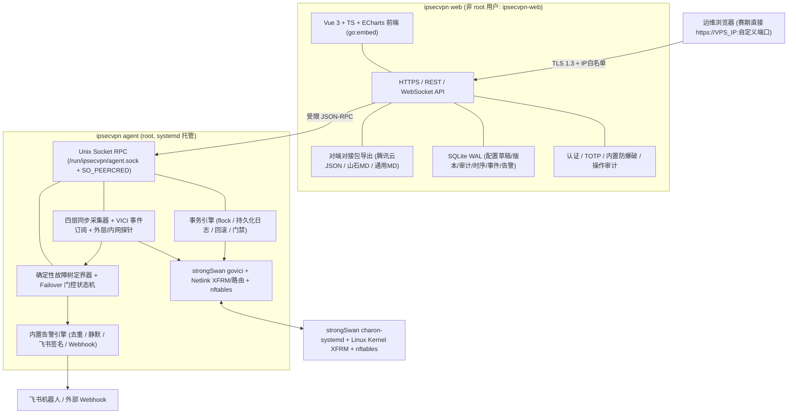

# event-ipsec-hub V4.0 架构与重构方案（Go + Vue 3 + strongSwan）

- **目标分支**：`v4-go`（基于 `main` 基线 `8765142`，V3.0 PR #17/#18 已合并）
- **产品定位**：面向电竞赛事与多站点私网互通的自托管 IPsec VPN 网关一体机（对标腾讯云 VPN 网关控制台体验：Web 端配置、四层同步排障监控、内置告警、多格式对端参数一键导出、主备门控与人工回切）
- **核心技术栈**：**Go**（核心 Agent + 监控/告警引擎 + Web API）+ **Vue 3 / TypeScript / ECharts**（`go:embed` 内嵌单二进制）+ **strongSwan (`charon-systemd`)** + **Linux Kernel XFRM & `nftables`**
- **关联未关闭 Issue**：原生覆盖 [#12（腾讯云托管 VPN 与自建 Hub 主备互换）](https://github.com/yikkrrtykj/event-ipsec-hub/issues/12) 与 [#14（安全生产 VPS 部署、只读预检与现场签收）](https://github.com/yikkrrtykj/event-ipsec-hub/issues/14)，为后续真机验收收官铺路。

---

## 1. 设计目标与架构原则

### 1.1 为什么演进到 V4（Go + Vue 3）
1. **单二进制交付**：编译为单个静态 Linux 二进制 `/usr/local/sbin/ipsecvpn`（通过 `//go:embed` 内嵌构建后的 Vue 3 前端），彻底消除 VPS 上的 Python venv、`pip` 依赖和系统升级 Python 版本漂移。
2. **开箱即用的自包含监控与告警**：摆脱对外部 Prometheus + Alertmanager + Grafana 三件套的强依赖，本地内置 SQLite 轻量时序（保留 7～30 天）与飞书/Webhook 告警引擎，同时保留 `/metrics` 兼容外部 Prometheus。
3. **毫秒级事件驱动与四层同步排障**：通过 `strongswan/govici` 订阅 IKE/CHILD 实时事件，结合 `vishvananda/netlink` 读取内核 XFRM/路由状态，在 Web 端呈现**同一时间轴联动**的四层排障视图与自动根因定界。
4. **单机一体优先，预留多 Hub 扩展**：默认每台 Hub VPS 独立运行完整能力；内部通过明确定义的 RPC 边界将 `web`（控制面/前端）与 `agent`（本地 root 执行面）解耦，未来只需替换传输层（Unix Socket → mTLS gRPC）即可升级为中心控制台统一管多台 Hub。
5. **去 Shell 化**：Shell 仅保留极薄的引导安装脚本（装 Ubuntu strongSwan 包、放置 Go 二进制、注册 systemd 单元），核心逻辑 100% 在 Go 中以强类型与单元测试保障。

### 1.2 沿用并坚守的 V2/V3 安全红线（不可退化）
- **数据面不变**：继续使用 Ubuntu 24.04 官方 `charon-systemd` + `strongswan-swanctl` + Linux Kernel XFRM + 项目独立 `nftables` 表（`table ip ipsecvpn`）。
- **权限最小化与隔离**：Web 服务进程**绝对不以 root 运行**；明文 PSK 只保存在 `/etc/ipsecvpn/secrets/`（root `0700`/`0600`），**不写入 SQLite 数据库**，网页保存后默认只写不回显。
- **所有权与外部基线保护**：沿用 `ifalias=ipsecvpn:<token>`、`proto 242`、独立 nft `owner_<token>` chain，启动前校验主机基线（SSH、默认路由、既有防火墙、sysctl），发现外来对象或冲突立即 `STOP`。
- **防明文泄漏（Fail-Closed）与事务回滚**：任何 `apply` / `rollback` / `uninstall` 必须经 `dry-run` 差异预览 → 显式确认 → 持久化事务日志 → 失败自动回滚；异常无法安全恢复时进入 `STOP_FOR_MANUAL` 闭锁。
- **证据真实性**：无新鲜证据不报告业务 UP/RECOVERED；继续区分隔离 QEMU 验收与真机现场签收。

---

## 2. 系统总体架构



### 2.1 单二进制多角色入口
同一个 `/usr/local/sbin/ipsecvpn` 二进制按子命令运行，降低发布与完整性校验成本：
- `ipsecvpn agent serve`：root 守护进程（`ipsecvpn-agent.service`），监听 `/run/ipsecvpn/agent.sock`（`0660 root:ipsecvpn-web`，并通过 `SO_PEERCRED` 校验对端 UID/PID），独占 VICI/Netlink/nftables/密钥读写。
- `ipsecvpn web serve`：非 root 守护进程（`ipsecvpn-web.service`），提供 HTTPS Web 控制台、REST/WebSocket API、SQLite 读写和静态前端托管；**无任何 `CAP_NET_ADMIN` 或读取 `/etc/ipsecvpn/secrets` 权限**。
- `ipsecvpn boot guard|restore`：开机 fail-closed 护栏与已提交配置恢复（对应原 `ipsecvpn-guard.service` / `ipsecvpn-restore.service`）。
- `ipsecvpn probe respond|run`：授权 LAN 端点的轻量 UDP Echo 应答/探针工具（无需安装 Python，单文件拷贝到测试机即可运行）。
- **兼容 CLI 子命令**：保留 `validate` / `check` / `plan` / `render` / `export-peer` / `install` / `apply` / `status` / `doctor` / `initiate` / `rekey` / `reconnect` / `backup` / `rollback` / `uninstall` / `failover` / `web enable|disable|allow-ip`，支持脱机急救和直接对接现有 QEMU 自动化验收套件。

---

## 3. 代码目录规划（`v4-go` 分支）

在 `v4-go` 分支中保留 `config/schema.json`、`tests/fixtures/`、`scripts/`（现有 QEMU 实验室验收套件）与 `docs/`，新增 Go 与 Vue 3 代码布局：

```text
event-ipsec-hub/
├── go.mod / go.sum
├── cmd/
│   └── ipsecvpn/
│       └── main.go                  # 统一 CLI / agent / web / boot / probe 入口
├── internal/
│   ├── profile/                     # 严格 YAML（禁 alias/重复键）+ JSON Schema 2020-12 + 拓扑校验
│   ├── manifest/                    # DeploymentManifest 推导、ivp%08x XFRM、exact/route_based/per_pair、双ISP策略路由
│   ├── handoff/                     # 对端对接导出：腾讯云精简 JSON、山石 MD、通用 MD、厂商参考片段、PSK 脱敏开关
│   ├── secureio/                    # openat/O_NOFOLLOW/fstat 防 TOCTOU、原子写、SHA-256 封装记录、密钥校验
│   ├── host/                        # govici(+SO_PEERCRED)、Netlink XFRM/Route/Rule/Link、nftables、主机基线指纹
│   ├── sa/                          # VICI SA 与内核 XFRM SPD/SAD 精确对账、生成号追踪
│   ├── live/                        # initiate、rekey 事件监听、drain、bounded reconnect、半开 SA 清理
│   ├── transaction/                 # flock 独占锁、持久化 journal、install/apply/backup/rollback/uninstall、STOP_FOR_MANUAL
│   ├── failover/                    # PRIMARY_ACTIVE / BACKUP_LOCKED / PRIMARY_RECOVERY_READY / MANUAL_STOP + XFRM 门控 + 主备互换(#12)
│   ├── telemetry/                   # 四层同步采集器、VICI 实时事件流、外层/内网探针、确定性故障树定界器、/metrics
│   ├── alert/                       # 内置告警规则评估、去重/冷却/静默、飞书 HMAC 签名推送、来源标签(自建/云侧)
│   ├── storage/                     # SQLite WAL 持久化（配置版本、审计、时序、时间轴事件、告警历史、用户会话）
│   ├── rpc/                         # web <-> agent 受限控制协议（Unix Socket 实现，预留 mTLS gRPC 接口）
│   └── web/                         # IP-SAN TLS、认证/TOTP/防爆破、REST + WebSocket、nft 白名单控制、go:embed
├── web/                             # Vue 3 + TypeScript + Vite + ECharts 前端工程
│   ├── src/views/
│   │   ├── DashboardView.vue        # 网关总览（隧道矩阵、实时吞吐、当前根因结论、主备状态）
│   │   ├── DiagnosticsView.vue      # 四层同步时间轴排障页（ECharts 联动十字准星 + 事件竖线 + 回放）
│   │   ├── SitesConfigView.vue      # 赛事/站点/双ISP/授权矩阵向导 + Dry-Run Diff + 应用/回滚
│   │   ├── PeerExportView.vue       # 一键生成对端配置包（腾讯云 JSON / 山石 / 通用 / 明文开关）
│   │   ├── FailoverView.vue         # 主备切换、门控锁状态、主备互换(#12)与人工确认回切台
│   │   ├── AlertsView.vue           # 飞书 Webhook 配置、告警规则、静默与推送历史
│   │   └── AuditSystemView.vue      # 变更审计、版本回滚、管理面白名单与真机签收单(#14)
│   └── embed.go                     # //go:embed dist/*
├── scripts/
│   ├── install-v4.sh                # 极薄引导脚本（装 strongSwan + 放二进制 + 启 systemd）
│   └── ...                          # 保留 pr2-vm / pr3-lab / pr4-lab / pr5-lab / v3-lab QEMU 套件
└── docs/
    └── V4_ARCHITECTURE.md           # 本文档
```

---

## 4. 核心子系统详细设计

### 4.1 四层同步时间轴排障与自动根因定界（Web 端核心体验）

#### 采集与时间对齐
所有采样点与异步事件统一使用 **UTC 毫秒时间戳** 写入 SQLite 并通过 WebSocket 实时推给前端，ECharts 通过 `echarts.connect('sync-diag')` 联动 4 张同步图表 + 共享时间范围滑块：

1. **L1 · 外层公网/ISP 质量轨道**（按站点 & ISP 出口分组）
   - 采集：绑定指定 `source_ip` / `wan` 出口对站点公网 Peer（或可配置的独立外层探测点）执行轻量 ICMP 探测，记录 RTT、抖动、丢包率。
   - **禁 Ping 兜底**：若远端防火墙禁用公网 ICMP，可在站点配置中设置独立同运营商外层参考目标，或自动标记 `outer_icmp=disabled` 并回退使用 strongSwan IKE DPD 往返延迟辅助判断。
2. **L2 · IPsec 控制面事件轨道**（事件驱动，毫秒级）
   - 采集：`govici` 长连接订阅 `ike-updown`、`child-updown`、`ike-rekey`、`child-rekey` 与关键协商错误（`TS_UNACCEPTABLE`、`AUTH_FAILED`、`NO_PROPOSAL_CHOSEN`、`DPD_TIMEOUT`）。
   - 前端展示：状态带（UP/CONNECTING/DOWN）+ **穿透 4 张图表的竖向事件标记线（`markLine`）**，鼠标悬停可看具体事件与 SA uniqueid 切换。
3. **L3 · 内核 XFRM 与防火墙数据面轨道**
   - 采集：Netlink 直读每个 XFRM 接口及 CHILD SA 的 `rx_bytes/tx_bytes`、`rx_packets/tx_packets`（计算实时 bps/pps），叠加 `/proc/net/xfrm_stat` 错误增量（`XfrmInError`、`XfrmInStateSeqError`、`XfrmOutError` 等）以及项目 `nftables` 表 `forward` drop 计数增量。
   - 目的：迅速发现“SA 显示 UP 但解密报错、Replay 窗口丢包、MTU 分片丢包、或被 OB 隔离 ACL 拦截”。
4. **L4 · 跨隧道端到端业务探测轨道**
   - 采集：沿用已验证的签名 UDP Echo 协议（`FRAME_BYTES=103` HMAC-SHA256 防伪造），按方向（`src_site -> dst_site`）绑定内网源地址定时采样，记录双向 RTT、P95、丢包率及 `source_preserved` 标志。
5. **运维与切备事件叠加**
   - 将配置 `apply`、`rollback`、`reconnect`、主备切换与 XFRM 门控操作一并作为竖线标在同一时间轴上，便于故障复盘。

#### 确定性故障树根因定界器（无幻觉、可解释）
针对任意选定时间窗口或当前实时状态，Go 后端输出唯一的定界码与证据摘要：

| 根因定界码 | 判定条件 | 展示给运维的直接结论 |
| --- | --- | --- |
| `ISP_OUTER_DEGRADED` | L1 外层丢包/超时（紧随或伴随 L2/L4 恶化） | 公网/运营商外层链路抖动或中断，优先查本地/对端 ISP |
| `IPSEC_SA_EVENT` | L1 正常，且窗口内存在 L2 `DOWN` / `REKEY` / `DPD_TIMEOUT` / 协商错误 | IPsec 隧道断开或重协商触发，查看对端防火墙日志或提议匹配 |
| `TUNNEL_BLACKHOLE_OR_ASYMMETRIC` | L1 正常 + L2 均 UP + L3 单向无回包或 L4 单/双向不通 | 隧道控制面在线但业务不通，疑似隧道黑洞、回程路由不对称或对端路由/NAT 豁免缺失 |
| `XFRM_CRYPTO_OR_MTU_DROP` | L1/L2 正常，L3 `xfrm_stat` 错误计数或分片错误增长 | 内核加解密/Replay/MTU 分片丢包，核对 MTU/MSS 与双端 SA 同步 |
| `ACL_POLICY_DROP` | L1/L2 正常，项目 `nftables` drop 计数器随业务请求同步增长 | 流量被 Hub 授权矩阵拦截（例如未授权网段或 OB 间隔离规则） |
| `VPN_HEALTHY_APP_SUSPECT` | L1/L2/L3/L4 全部健康且无错误增量 | VPN 隧道与跨站网络健康，请排查游戏服务器/OB 客户端或本地局域网 |
| `OBSERVATION_UNVERIFIED` | 采集器超时、基线漂移或无活跃探针 | 观测数据不完整（`UNKNOWN`），拒绝冒充正常或恢复 |

---

### 4.2 一键生成对端配置包（含腾讯云同款精简 JSON）

面向“对端防火墙由合作方/场馆网工配置”的真实场景，Web 端在站点详情页提供 **「导出对端对接包」** 弹窗：

1. **格式 1：腾讯云同款精简 JSON（`--format tencent-json`）**
   结构直观映射腾讯云 VPN 网关参数单风格，但**强制采用 IKEv2 强加密算法**（绝不输出弱算法 IKEv1/SHA1/DH1）：
   ```json
   {
     "Meta": {
       "Classification": "PEER_HANDOFF_PARAMETERS",
       "EventId": "esports-spring-2026",
       "LocalSiteId": "ob-venue-1",
       "RemoteHubId": "hub-vps-primary",
       "SelectorMode": "route_based",
       "ProfileSha256": "<sha256>"
     },
     "IKEOptionsSpecification": {
       "IKEVersion": "IKEV2",
       "PropoEncryAlgorithm": "AES-CBC-256",
       "PropoAuthenAlgorithm": "SHA256",
       "PrfAlgorithm": "PRF-HMAC-SHA256",
       "DhGroupName": "GROUP14",
       "IKESaLifetimeSeconds": 28800,
       "DpdDelaySeconds": 30,
       "LocalIdentityType": "FQDN",
       "LocalIdentity": "ob-venue-1.example",
       "RemoteIdentityType": "FQDN",
       "RemoteIdentity": "hub-vps-primary.example",
       "LocalAddress": "203.0.113.21",
       "RemoteAddress": "198.51.100.10"
     },
     "IPSECOptionsSpecification": {
       "Mode": "TUNNEL",
       "Protocol": "ESP",
       "EncryptAlgorithm": "AES-CBC-256",
       "IntegrityAlgorithm": "SHA256",
       "PfsDhGroup": "GROUP14",
       "IPSECSaLifetimeSeconds": 3600
     },
     "SecurityPolicyDatabaseSet": [
       {
         "LocalCidrBlock": "0.0.0.0/0",
         "RemoteCidrBlock": ["0.0.0.0/0"]
       }
     ],
     "AuthorizedTrafficAndRouting": {
       "LocalLanCidrs": ["10.101.10.0/24"],
       "RemoteLanCidrs": ["10.100.10.0/24", "10.100.20.0/24"],
       "RoutePriority": 10,
       "NatExemptionRequired": true,
       "SourceNat": false
     },
     "PreShareKey": "<SEND_SEPARATELY>"
   }
   ```
   - `selector_mode` 为 `exact` 或 `per_pair` 时，`SecurityPolicyDatabaseSet` 自动填充精确授权网段对；为 `route_based` 时填充 `0.0.0.0/0 <-> 0.0.0.0/0` 并在 `AuthorizedTrafficAndRouting` 明确要求静态路由 + 安全策略 + NAT 豁免。
2. **格式 2：山石 StoneOS / 通用厂商 Markdown 参数单**：完整保留 V2/V3 的接收方视角参数表、双向安全区、备线与现场签收栏。
3. **格式 3：厂商参考 CLI 草稿（山石 StoneOS / strongSwan / 华为 / 飞塔参考片段）**：显式标注占位符（接口名、VR、Zone 名称）与 `NOT_APPLYABLE_CONFIG`，协助对端网工快速对照。
4. **PSK 安全交付开关**：
   - 默认导出始终脱敏（`<SEND_SEPARATELY>`）；
   - 页面提供 **「含明文 PSK 的一次性交付文件」** 选项：需要再次输入管理员密码或二次确认 → `web` 经受控 RPC 向 `agent` 临时读取并生成单次下载流（不落盘、不缓存）→ 写入不可删审计日志（记录操作人、站点、时间、来源 IP）。

---

### 4.3 SQLite 数据模型与配置真相源

- 数据库路径：`/var/lib/ipsecvpn/gateway.db`（WAL 模式，`busy_timeout=5000`，`ipsecvpn-web` 可读写）。
- **核心设计**：SQLite 为 Web 控制台配置与观测真相源；每次生效部署时，`agent` 将已提交 Profile 的权威规范快照同时固化至 root-only 状态文件（`/var/lib/ipsecvpn/active.json`），确保**即使 Web 进程崩溃或数据库异常，开机 `boot restore` 与底层 CLI 救火依然完全独立可用**。
- **核心表结构**：
  - `profiles` / `profile_revisions`：多赛事 Profile 管理、草稿态/已提交态、完整 JSON/YAML 版本历史与 SHA-256 摘要，支持一键对比 Diff 与回滚。
  - `secrets_meta`：仅记录密钥引用名、最后更新时间与 SHA-256 指纹（**绝不存明文 PSK 或飞书 Webhook URL**；写入密钥通过 RPC 直接由 `agent` 原子写入 `/etc/ipsecvpn/secrets/`）。
  - `metric_samples`：15 秒粒度四层结构化指标（外层 RTT/丢包、SA 状态、XFRM 收发速率与错误增量、UDP 业务探测 RTT/P95/丢包），按配置保留 7～30 天并自动按小时聚合/清理，磁盘占用严格有上限（预计 < 200 MB/月）。
  - `timeline_events`：毫秒级离散事件（VICI IKE/CHILD 变更、配置 apply/rollback、failover 切备/解锁、告警触发/恢复），含根因定界码与上下文 JSON。
  - `alert_rules` / `alert_history`：告警阈值、去重冷却窗口、静默时段、飞书/Webhook 推送回执与来源标识（区分自建 Hub vs 云侧/备线）。
  - `audit_logs` / `users`：操作审计（谁在何时从哪个 IP 做了什么变更或明文导出）与管理员/只读观察员账号。

---

### 4.4 赛期直接 IP 访问 Web 的四重安全护栏

面向“比赛期间一个月直接通过 `https://<VPS_IP>:<PORT>` 打开网页管理”的场景：
1. **自动 IP-SAN TLS 1.3 + 自定义高端口**：初始化时自动签发以 VPS 公网 IP 为 `IP SAN` 的长期自签证书（同时支持上传/替换自有证书），强制 HTTPS，拒绝明文 HTTP。
2. **强认证与内置防爆破**：初始化生成随机高强度密码（首登强制修改）+ 可选 TOTP 二次验证 + 内置令牌桶与失败封禁（同 IP 连续失败自动锁定，记录审计）。
3. **`nftables` 管理面动态白名单与一键开关**：
   - 在项目独立 `nftables` 表中维护受控的管理面放行集合（`ipsecvpn_mgmt_allow`），支持在 Web 或 CLI 一键增删允许访问的来源 IP/CIDR（如导播间/家庭/场馆出口 IP）；
   - 支持设置**赛期截止时间**或赛后执行 `ipsecvpn web disable` 直接停服并移除监听规则。
4. **双进程权限隔离 + 变更必过事务门禁**：Web 进程无 root 权限；所有变更请求先返回 `dry-run` 差异清单，管理员确认后由 root `agent` 执行原子事务并在失败时自动回滚。

---

### 4.5 覆盖 `#12`（主备角色互换）与 `#14`（安全生产签收）

- **原生支持 `#12`**：Profile 的 `backup` 与 `hub` 明确支持主备角色声明（`hub_role: primary | backup`），可在 Web 端清晰切换和配置“自建主 ↔ 腾讯云备”或“腾讯云主 ↔ 自建备”两种拓扑，统一展示两端 Track 参数、备线中转核验状态（未证实中转时保持 `STOP`）及来源标识。
- **原生支持 `#14`**：Web 端内置 **「生产准入与现场签收」** 页面，集成 `host-authorized` 授权状态核验、只读预检报告、一键事务备份/回滚测试记录以及可导出的脱敏赛前签收单。

---

## 5. 测试验证与 QEMU 回归策略

重构期间，代码级与内核级验证**持续执行，不拖到最后**：
1. **Go 单元测试与契约测试**（本机 Windows + CI Linux）：覆盖 YAML 严格解析、Schema 2020-12 校验、拓扑冲突、腾讯云/山石导出、故障树定界器、告警去重、SQLite 存储与 RPC 鉴权。
2. **复用现有 QEMU 真内核实验室**（GitHub Actions Ubuntu 24.04）：
   - 在 `scripts/pr2-vm/guest.sh` 中支持选择运行 Go 编译产物（`IPSECVPN_IMPL=go`），直接复用现有的 `pr2-vm`、`pr3-lab`、`pr4-lab`、`pr5-lab`、`v3-lab` 验收套件对 Go 二进制做黑盒回归。
3. **前端构建与交互验证**：`npm run type-check`、`npm run build`（验证 `go:embed` 完整编译 Linux `amd64` 静态单二进制）以及 mock 数据下的四层联动排障页端到端检查。
4. **真机与真实云环境验收（M4）**：待重构完成并具备真实 VPS、山石防火墙与腾讯云 VPN 环境后，统一执行实测并关闭 `#12` 与 `#14`。

---

## 6. 分阶段实施路线图

### 里程碑 M1：Go 核心 Agent、CLI 契约与网络/事务平面
- 初始化 `go.mod` 与工程骨架，建立 CI（`go test`、`golangci-lint`/vet、Linux `amd64` 交叉编译）。
- 实现 `internal/profile`（严格 YAML + Schema 2020-12 + 拓扑规则）、`internal/manifest`、`internal/handoff`（含**腾讯云同款精简 JSON**、山石/通用 Markdown）。
- 实现 `internal/secureio`、`internal/host`（`govici` + `SO_PEERCRED`、Netlink XFRM/Route/Rule、`nftables`、主机基线）、`internal/sa`、`internal/live`、`internal/transaction`、`internal/failover`。
- **M1 验收门槛**：Go 单测全绿 + 现有 QEMU 实验室（PR2 / PR3 / V3 核心用例）对 Go 二进制全部通过。

### 里程碑 M2：四层同步采集引擎、故障定界、SQLite 与内置告警
- 实现 `internal/storage`（SQLite WAL + 指标保留清理 + 审计表）。
- 实现 `internal/telemetry`：VICI 实时事件订阅、L1 外层探针（含禁 Ping 降级）、L3 XFRM/nft 指标、L4 UDP Echo 探针（含 `ipsecvpn probe` 独立子命令）、确定性故障树定界器、`/metrics` 兼容输出。
- 实现 `internal/alert`（规则引擎、去重静默、飞书签名推送 & 通用 Webhook）。
- **M2 验收门槛**：故障注入测试验证 6 类根因定界准确 + PR4/V3 监控与飞书告警回归通过。

### 里程碑 M3：权限隔离 RPC、Vue 3 控制台、安全直连与单二进制发布
- 实现 `internal/rpc`（Unix Socket + `SO_PEERCRED` 校验）与 `internal/web`（IP-SAN TLS、认证/TOTP/防爆破、nft 白名单、REST + WebSocket、`go:embed`）。
- 构建 `web/`（Vue 3 + TypeScript + ECharts）：总览大盘、**四层同步时间轴排障页**、站点与双 ISP 配置向导（Dry-Run Diff + 一键回滚）、**对端对接包一键导出页**、主备门控与角色互换台、告警与审计签收页。
- 编写极薄引导脚本 `scripts/install-v4.sh` 与 systemd 双单元（`ipsecvpn-agent.service` + `ipsecvpn-web.service` + `guard`/`restore`）。
- **M3 验收门槛**：Ubuntu 24.04 QEMU 完整跑通“单二进制安装 → Web IP HTTPS 登录 → 网页配置生效 → 故障注入四层同步定界 → 飞书告警 → 导出腾讯云/山石参数单 → 一键回滚”。

### 里程碑 M4：真机与真实云环境收官（关闭 #12 & #14）
- 在真实 Ubuntu 24.04 VPS + 山石 StoneOS + 腾讯云托管 VPN + 真实飞书完成上线、双向业务、主备角色互换与签收归档。
