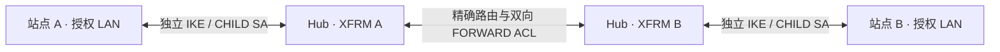

# 通用赛事架构

## 一台 Hub 与两个外部站点

站点 A 发往 B 的流量将在 Hub 解密、经授权路由转发，再通过另一条隧道加密，保留源 IP。B 到 A 采用对称的转发策略。PR #1 根据 profile 推导下表和两条独立的 `if_id`，现场行为待隔离实验验证。

| CHILD SA | Hub 本端 TS | Hub 远端 TS | 站点本端 TS | 站点远端 TS |
| --- | --- | --- | --- | --- |
| Hub ↔ A | B 的授权 LAN | A 的授权 LAN | A 的授权 LAN | B 的授权 LAN |
| Hub ↔ B | A 的授权 LAN | B 的授权 LAN | B 的授权 LAN | A 的授权 LAN |

两条外层路径分别保留 Peer 公网 IPv4 的 `/32` 路由意图及出口参数，避免 Peer 地址进入 XFRM。Hub 内层只计划授权 LAN 的精确路由。计划包含双向 ACL 和 NAT 豁免意图，任何系统状态或真实连通性均需后续验收。

## Profile 结构

| 字段 | 用途 |
| --- | --- |
| `event`、`hub` | 赛事标识、Hub 公网 IPv4、可选 IKE ID，以及供应商和地区标签。省略 Hub IKE ID 时使用其公网 IPv4。 |
| `sites[]` | 两个站点的 ID、显示名、角色、位置、固定公网 IPv4、IKE ID、设备和 LAN。可用 `uplinks[]` 登记站点运营商、出口和公网地址。 |
| `site_links[]` | 每站一条独立链路，配置 `if_id`、专用 PSK 文件引用、Hub 出口与运营商，可选源 IP、下一跳和站点主路由优先级。 |
| `security` | 共享 IKE/ESP 提议、SA 生存期和 DPD，链路可覆盖 IKE/ESP 提议。示例兼容参数需双方核对。 |
| `traffic_policy.allowed_site_pairs` | 一条双向站点授权。只填 `a`、`b` 时授权两站列出的全部 LAN。可同时填 `a_cidrs`、`b_cidrs` 选择各自已声明的 LAN，互通范围为两侧列表的组合。 |
| `backup` | `enabled: false` 即完整配置。启用时登记 `external_managed`，可逐站填写备 Peer、运营商出口、隧道名、受限路由、优先级和 Track 目标。 |
| `monitoring` | 可选的探针、阈值和通知文件引用，留待 P1 运行。 |

站点 ID 区分大小写，由字母、数字、下划线和连字符组成，首字符为字母或数字，最长 63 字符。显示名称、角色、供应商和国家可使用中文或其他语言。公网端点使用互不冲突的固定 IPv4，示例可使用 RFC 5737 地址。路由必须是规范 IPv4 CIDR，例如 `10.45.0.0/24`。校验会拒绝 LAN 重叠、通配选择器、外层地址落入 LAN、未知站点和未授权 CIDR。

`outer_path.interface: auto` 仅用于离线模板。实际部署前须核对具体出口、下一跳、源地址和两端路由。IKE 使用 IKEv2，默认 AES-256-CBC、SHA-256 和 DH14。支持 V2 schema 所列安全提议及 ESP PFS。山石如需通配选择器或无法协商多 CIDR，应暂停并安排独立兼容性验证。

外部备网关可由任意供应商管理，例如腾讯云。管理员分别核对主备外层路由、回程和 Track 目标。两端都验证切换和回切后，再决定是否启用自动 Track。若两端无法可靠收敛，采用协调的人工切换。

## 版本迁移

`schema_version: "2.0"` 是当前配置格式。旧版 profile 从 [V2 示例](../config/event.example.yaml) 重新建立，逐项迁入两站点、链路、明确的 CIDR 授权和可选备网关，随后重新执行校验和两端导出。V2 解析器拒绝旧版本、未知字段、重复 YAML 键和 YAML 别名。三站及以上会明确返回 `UNSUPPORTED`。后续版本的新增格式须提供显式迁移和兼容性说明。
